# RV Fitness, Narsobawadi: Project Documentation

This document covers the gym website and management portal: every screen, what each function does, and how it works behind the scenes.

> **About the screenshots.** They were taken from the running app (`npm run dev`) on 20 Oct 2026.
> - **Public website:** shows the real content.
> - **Member, trainer and admin portal:** the screens were filled with **sample data** (for example the member "Rahul Sharma" and the trainer "Vikram Sharma") so every feature is visible.
> - **Demo role buttons:** the dev-only role buttons on the Login page were used to open each portal.

---

## Contents
1. [Overview](#1-overview)
2. [How the system is built](#2-how-the-system-is-built)
3. [User roles and what each can do](#3-user-roles-and-what-each-can-do)
4. [Public website](#4-public-website)
5. [Accounts: login, sign-up, passwords](#5-accounts-login-sign-up-passwords)
6. [Member portal](#6-member-portal)
7. [Trainer panel](#7-trainer-panel)
8. [Admin panel](#8-admin-panel)
9. [Website Editor (Super Admin)](#9-website-editor-super-admin)
10. [Photos and privacy](#10-photos-and-privacy)
11. [Backend API](#11-backend-api)
12. [Database and security](#12-database-and-security)
13. [Setup, testing and deployment](#13-setup-testing-and-deployment)
14. [Feature status: live, sample data or simulated](#14-feature-status-live-sample-data-or-simulated)
15. [Known limitations and next steps](#15-known-limitations-and-next-steps)

---

## 1. Overview

| | |
|---|---|
| **Business** | RV Fitness, Narsobawadi (Maharashtra). Founder: Rushikesh Arvind Vagare. |
| **What it is** | A public gym website plus a login-protected portal for members, trainers, the gym owner and the Super Admin. |
| **Main goals** | Bring in new members (enquiries, free visit bookings, plans). Give members their QR pass, plans and progress. Let trainers send diet and workout plans. Let the owner run the gym. Let the Super Admin edit the website without code changes. |

**Technology**

| Part | Technology |
|---|---|
| Website and portal | React 18 + TypeScript, Vite, Tailwind CSS, React Router, Framer Motion, Recharts |
| Backend API | Next.js 14 (route handlers under `/api/v1`), Zod validation |
| Database, login, file storage | Supabase: PostgreSQL with Row Level Security, Supabase Auth, Supabase Storage |
| Payments | Razorpay (currently simulated, see [section 14](#14-feature-status-live-sample-data-or-simulated)) |
| Tests | Vitest + Testing Library (148 web tests, 12 API tests) |

---

## 2. How the system is built

```
Browser (React app, apps/web)
   │
   ├── Supabase Auth ........ email/password login, sign-up, password reset
   ├── Supabase database .... profiles, plans, diet/workout plans, progress, website content
   │                          (every request is checked by Row Level Security rules)
   ├── Supabase Storage ..... avatars (public), site-media (public), progress-photos (private)
   │
   └── Next.js API (apps/api) /api/v1/...
          leads, trial bookings, plans, classes, trainers, checkout, Razorpay webhook
          (uses the Supabase service key on the server only)
```

**Folder map**

| Folder | Contents |
|---|---|
| `apps/web/src/pages/public` | Public website pages |
| `apps/web/src/pages/auth` | Login, Sign Up, Forgot Password, Reset Password |
| `apps/web/src/pages/member` | Member portal pages |
| `apps/web/src/pages/trainer` | Trainer panel |
| `apps/web/src/pages/admin` | Admin panel, Users & Roles, Website Editor |
| `apps/web/src/components` | Shared UI (buttons, cards, modals), layout (navbar, footer), account (avatar, photo picker, My Trainer card), progress timeline, calculators |
| `apps/web/src/context` | `AuthContext` (who is logged in), demo profiles for local development |
| `apps/web/src/content` | Editable website content: defaults and editor field definitions |
| `apps/web/src/services` | All data calls: `api.ts` (Next.js API), `portal.ts` (users, plans, photos, progress), `content.ts` (website content) |
| `apps/web/src/config` | `site.ts` (gym details, plans and prices), `roles.ts` (who can do what) |
| `apps/web/src/routes` | `ProtectedRoute`, the login and role guard |
| `apps/api/app/api/v1` | Backend API routes |
| `supabase/migrations` | Database schema and security rules (`01`–`05`) |
| `docs` | This document, setup, deployment, API and admin guides |

---

## 3. User roles and what each can do

| Role | Who | After login goes to | Can do |
|---|---|---|---|
| **Super Admin** | The developer / platform owner | Admin panel | Everything, plus the **Website Editor** and granting Gym Owner / Super Admin access |
| **Gym Owner** | The client | Admin panel | Members, leads, attendance, financials, reports, Users & Roles (members, trainers, receptionists, managers) |
| **Manager** | Optional senior staff | Admin panel | Same as the owner except granting owner access |
| **Receptionist** | Front desk (optional) | Admin panel | Dashboard, members, leads, attendance scanner, financials. **No** Users & Roles, no Website Editor, no body photos. |
| **Trainer** | Coaches | Trainer panel | Their assigned members: diet plans, workout plans, progress photos |
| **Member** | Gym members | Member portal | Their QR pass, plans, payments, attendance, classes, progress, profile |

**How access is enforced (two layers)**
1. **In the app:** `ProtectedRoute` sends signed-out visitors to `/login`. It sends a signed-in user who opens the wrong area (for example a member on `/admin`) to their own home page. Menu items are shown by role (`config/roles.ts`).
2. **In the database:** Row Level Security rules mean that even if someone bypasses the app, they can only read and write what their role allows (see [section 12](#12-database-and-security)).

**Rules about roles**
- New sign-ups are always **Members**.
- Nobody can change their own role.
- Only the Super Admin can make someone a Gym Owner or Super Admin.
- Only staff can assign a trainer to a member.

---

## 4. Public website

**Shown on every public page:**
- the offer strip
- the top info bar (phone, location, hours, tagline)
- the navigation
- the footer
- floating **Call** and **WhatsApp** buttons

**Editable content:** most text and photos come from the **Website Editor** ([section 9](#9-website-editor-super-admin)). If nothing has been saved, the built-in content shows.

### 4.1 Home (`/`)
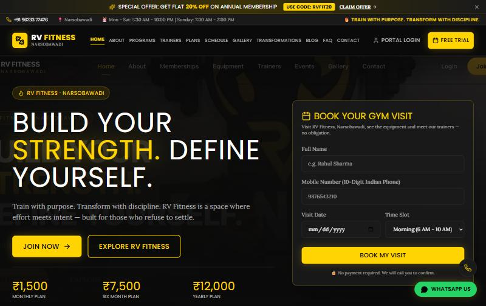

| Function | How it works |
|---|---|
| Hero headline, text and background image | From Website Editor → Home Page |
| **Join Now** / **Explore RV Fitness** | Go to `/plans` and `/about` |
| Plan prices under the hero | From the plans list (`config/site.ts`, names editable) |
| **Book Your Gym Visit** form | Name, 10-digit mobile, date and time slot. Sends `POST /api/v1/trial-bookings`, which validates and saves to the `trial_bookings` table. A hidden "honeypot" field blocks spam bots. Shows a success or error message. |

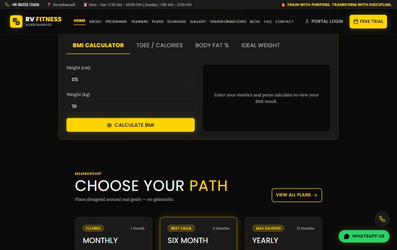

| Function | How it works |
|---|---|
| **Fitness calculators** (tabs) | All run in the browser; nothing is saved. **BMI** = weight ÷ height² with a category. **TDEE / calories** uses the Mifflin-St Jeor formula × activity level, showing maintenance, −500 kcal for fat loss and +400 kcal for gain. **Body fat %** uses the U.S. Navy formula (neck, waist, hips). **Ideal weight** uses the Devine formula with a ±10% range. |
| **Choose Your Path** plan cards | The three plans with features. The buttons go to `/plans`. |

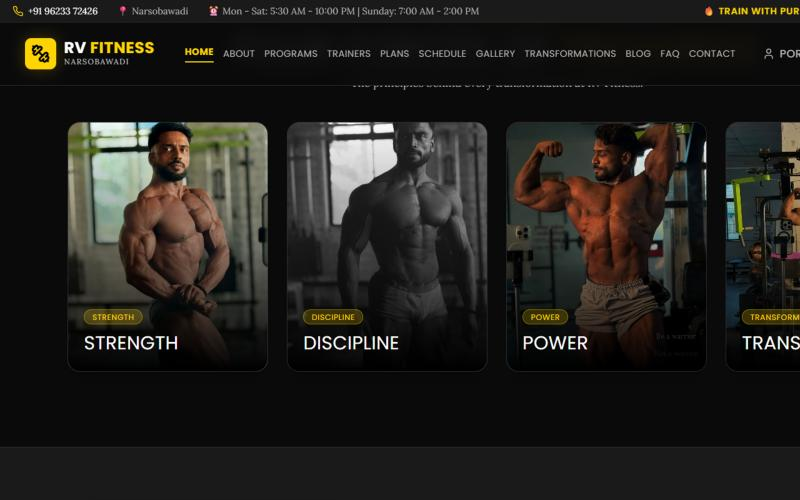

| Function | How it works |
|---|---|
| "Why RV Fitness" cards, mindset photo cards, philosophy, map | Text from the Website Editor (Home Page and About Page). The map is a Google Maps embed of the gym's location. |

### 4.2 About (`/about`)


| Function | How it works |
|---|---|
| Story, principles, two photos, mindset words | Website Editor → About Page |
| **Visit RV Fitness Today** | Goes to `/contact` |

### 4.3 Programs (`/programs`)
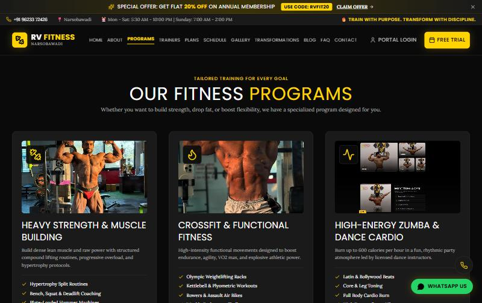
- Shows a card for each training program: image, description and benefits.
- Programs can be edited, added or removed in the Website Editor → Programs.
- **Book Program Consultation** goes to `/contact`.

### 4.4 Trainers (`/trainers`)

- Shows a card for each coach: photo, rating, specialization, experience and bio.
- **Filter buttons** (All / Strength / Yoga …) are built automatically from each trainer's *category*.
- **Book PT Session** goes to `/contact`.
- Edited in Website Editor → Trainers.

### 4.5 Membership Plans (`/plans`)
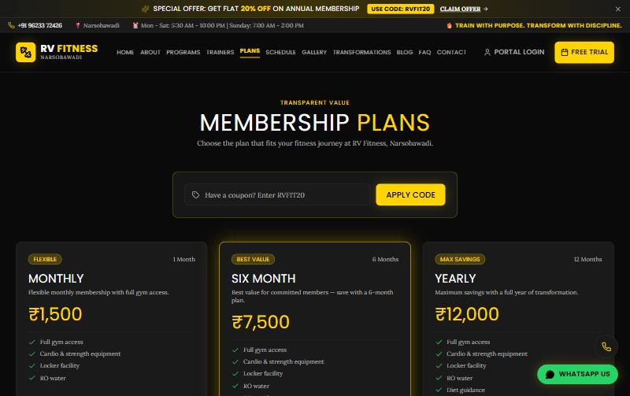

| Function | How it works |
|---|---|
| Plan cards and comparison table | Monthly ₹1,500 · Six Month ₹7,500 · Yearly ₹12,000. Prices are fixed in code because the payment server charges them; names, features and badges are editable. |
| **Coupon box** | Accepts `RVFIT20` (20% off, shown on the page only). See [section 15](#15-known-limitations-and-next-steps). |

### 4.6 Class Schedule (`/schedule`)
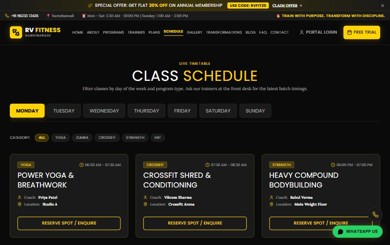
- **Day tabs** and **category filters** show the classes for that day.
- **Reserve Spot / Enquire** goes to the contact page.
- The timetable is currently written in the page code, not in the Website Editor.

### 4.7 Gallery (`/gallery`)

- Shows a grid of photos with category filters.
- Clicking a photo opens a larger view.
- Edited in Website Editor → Gallery, with image upload.

### 4.8 Transformations (`/transformations`)
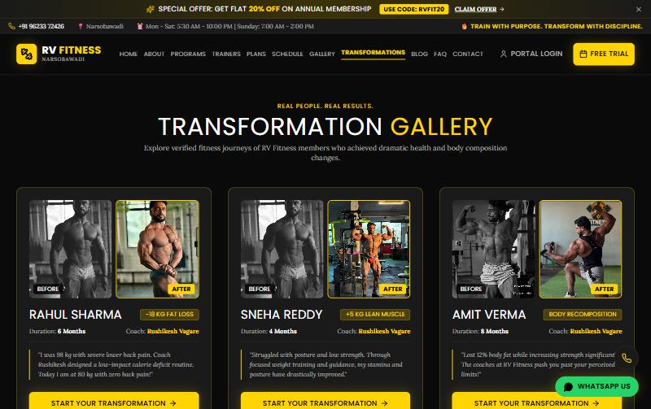
- Shows before/after stories: result, duration, coach and the member's quote.
- Edited in Website Editor → Transformations.

### 4.9 Blog (`/blog`, `/blog/<slug>`)

- Shows article cards. **Read Full Article** opens `/blog/<slug>`.
- Paragraphs are separated by a blank line.
- An unknown link shows "Article not found".
- Edited in Website Editor → Blog.

### 4.10 FAQ (`/faq`)
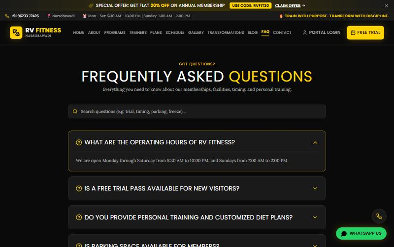
- **Search box** filters questions and answers as you type.
- Each question opens and closes on click.
- Edited in Website Editor → FAQ.

### 4.11 Contact (`/contact`)
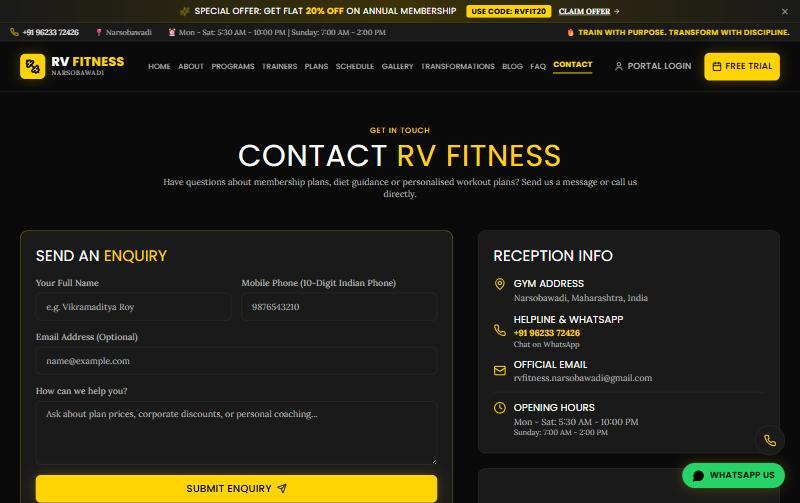

| Function | How it works |
|---|---|
| **Send an Enquiry** form | Name, mobile, optional email and message. Sends `POST /api/v1/leads` (validated, honeypot spam check) and saves to the `leads` table. The form clears on success; readable errors show on failure. |
| Reception info | Address, phone (tap to call), **Chat on WhatsApp**, email and hours, from Website Editor → Gym Details |
| Map | Google Maps embed |

### 4.12 Policies (`/policies`)
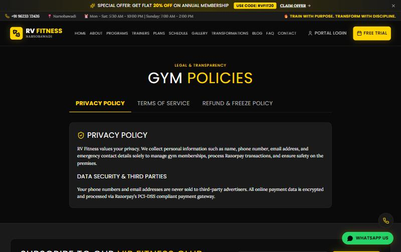
- Tabs for **Privacy Policy**, **Terms of Service** and **Refund & Freeze Policy**.

### 4.13 Footer, offer pop-up, mobile
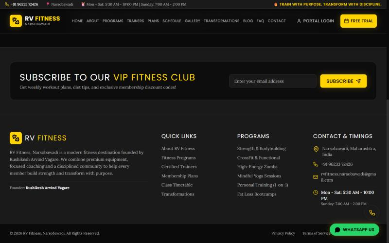
- **Footer:**
  - newsletter signup (shows a confirmation; not yet connected to an email service)
  - quick links and program links
  - contact details and hours
  - founder name
  - Instagram link (shown only if a handle is set)


- **Offer strip and pop-up:**
  - The pop-up appears once per browser visit after 3 seconds.
  - **Copy Code** copies the coupon.
  - **View Plans & Claim** goes to `/plans`.
  - The strip, the pop-up and the coupon can each be turned on or off and edited in Website Editor → Offer Banner.

| Mobile home | Mobile menu |
|---|---|
|  | 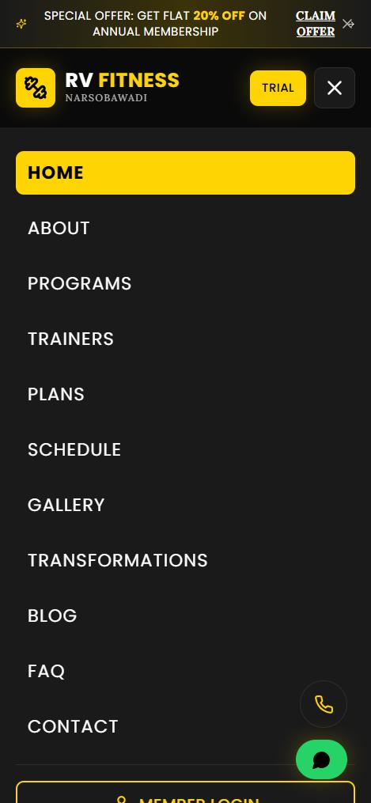 |

- **Mobile:** the whole site adapts to phone screens. The ☰ button opens the full menu, including **Member Login**.

---

## 5. Accounts: login, sign-up, passwords

All accounts use **Supabase Auth with email and password**.

### 5.1 Login (`/login`)
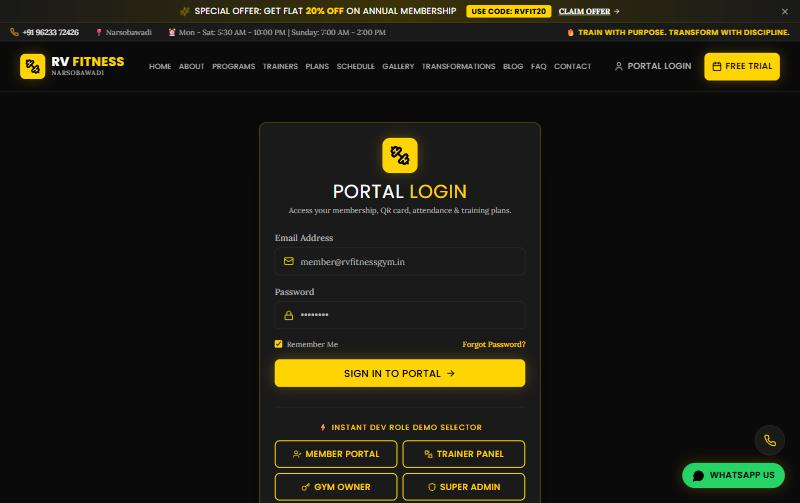

| Function | How it works |
|---|---|
| **Sign In to Portal** | Calls `supabase.auth.signInWithPassword`, loads the user's row from the `profiles` table (which holds the **role**), then redirects: member → `/portal/dashboard`, trainer → `/trainer/dashboard`, staff, owner and Super Admin → `/admin/dashboard`. If the user was sent to login from a protected page, they return to that page. |
| Wrong password | Shows Supabase's message, e.g. "Invalid login credentials" |
| Already signed in | Visiting `/login` redirects straight to the user's home page |
| Account without a profile row | Shows "Your account has no member profile yet. Please contact the front desk." |
| **Forgot Password?** | Goes to `/forgot-password` |
| **Instant Dev Role Demo Selector** | **Local development only** (`npm run dev`). One click opens any portal as a demo user. It is **removed from production builds** and cannot be enabled on the live site. |

### 5.2 Sign Up (`/signup`)
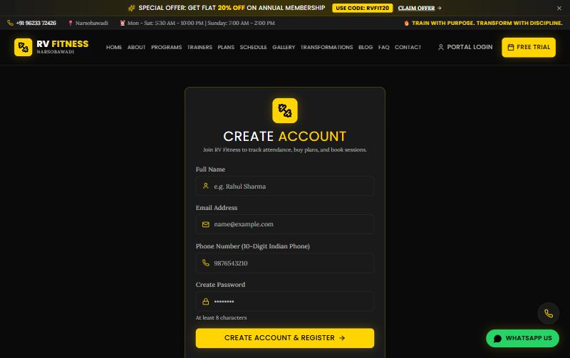
- **Checks before submitting:** a valid 10-digit Indian mobile (starting 6–9) and a password of at least 8 characters.
- **Creating the account:** calls `supabase.auth.signUp` with the name and phone. A database trigger creates the `profiles` row with role **member**; the role cannot be set from the browser.
- **If email confirmation is on:** shows "Check your email". Otherwise the user is signed in and taken to the portal.
- **Owners and trainers** also sign up here, then an admin gives them their role in Users & Roles.

### 5.3 Forgot Password (`/forgot-password`) and Reset Password (`/reset-password`)
| Forgot password | Reset link page |
|---|---|
| 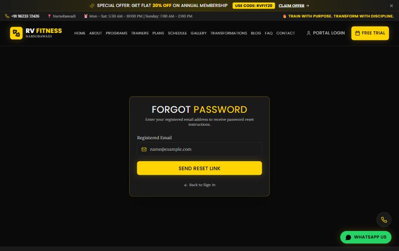 | 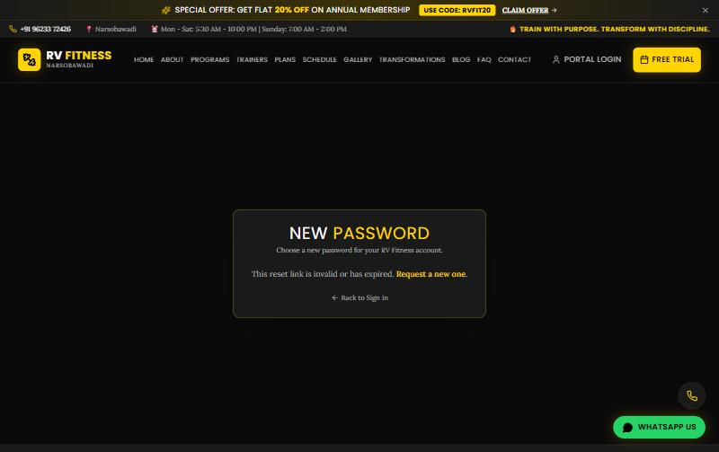 |

1. The user enters their email. The app calls `resetPasswordForEmail` and shows "Reset link sent".
2. The email link opens `/reset-password`. The user enters the new password twice (min. 8 characters). The app calls `updateUser({ password })` and takes them to their portal.
3. If the link is old or invalid, the page says so and offers to request a new one (the right-hand screenshot).

### 5.4 Change Password (all portals)
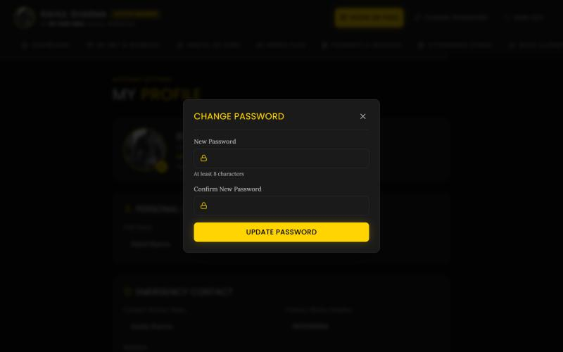
- Available in the member portal header, the trainer panel and the admin sidebar.
- The new password must be at least 8 characters and typed twice to match. Saved with `updateUser`.

### 5.5 Sign Out
**Sign Out** or **Exit Terminal** calls `supabase.auth.signOut`, clears the session and returns to `/login`.

---

## 6. Member portal

**Header:**
- photo (links to My Profile), name and phone
- **Show QR Pass**, **Change Password** and **Sign Out**
- a scrollable tab bar for the portal pages

### 6.1 Dashboard (`/portal/dashboard`)
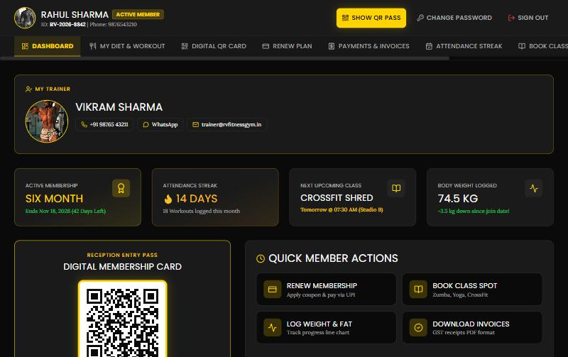

| Function | How it works |
|---|---|
| **My Trainer card** | The assigned trainer's **photo**, name, **tap-to-call**, **WhatsApp** and email. Loaded with the database function `get_my_trainer()`, which only returns the signed-in member's own trainer. If none is assigned: "No trainer assigned yet". |
| Membership, streak, next class, weight cards | Sample data at present ([section 14](#14-feature-status-live-sample-data-or-simulated)) |
| QR card and Quick Member Actions | Shortcuts to the QR pass, renewal, class booking, progress and invoices |

### 6.2 My Diet & Workout (`/portal/plans`)
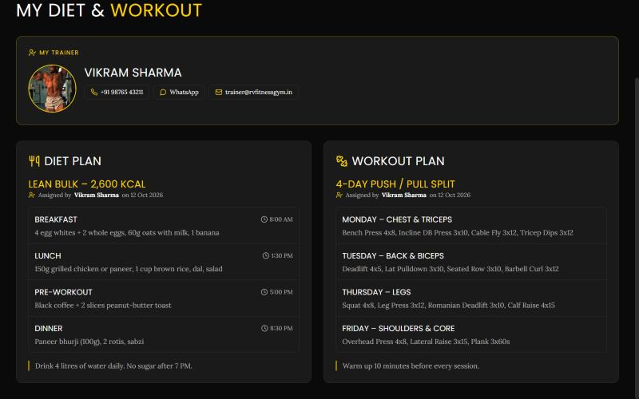
- **Diet plan:** title, who assigned it and when, each meal with its time and foods, and the trainer's notes.
- **Workout plan:** each training day with its exercises, plus notes.
- **Where the data comes from:** the newest **active** plan in the `diet_plans` and `workout_plans` tables for this member. The database only lets a member read **their own** plans.
- **If no plan exists yet:** a friendly message. If the database can't be reached, a clear error replaces the cards.

### 6.3 Digital QR Card (`/portal/digital-card`)
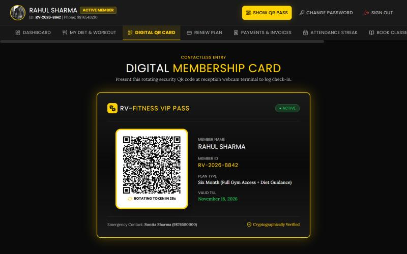
- A membership pass with a **QR code** that refreshes every 30 seconds, plus name, member ID, plan, expiry and emergency contact.
- Shown at reception to check in. The member ID, plan and dates are sample values for now.

### 6.4 Renew Plan / Checkout (`/portal/checkout`)
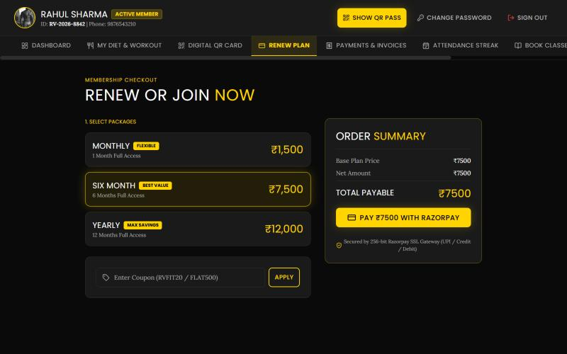
- Pick a plan and optionally apply a coupon (`RVFIT20` = 20%, `FLAT500` = ₹500). The order summary updates (GST is 0% by default, set in `config/site.ts`).
- **Pay with Razorpay** is **simulated**: after 1.5 seconds it shows "Payment successful" with a made-up order ID. **No money moves and nothing is saved.** Real Razorpay needs the owner's keys and the payment-flow work listed in [section 15](#15-known-limitations-and-next-steps).

### 6.5 Payments & Invoices (`/portal/payments`)
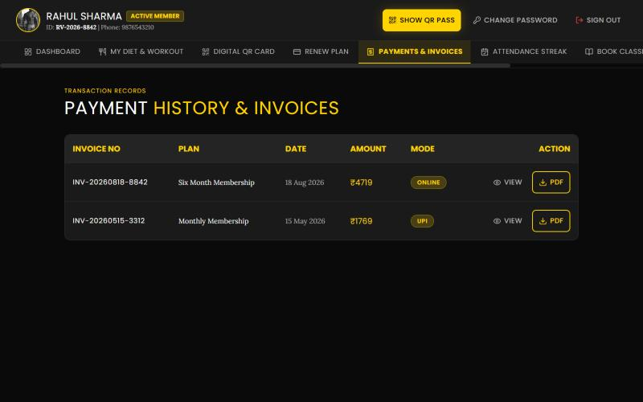
- A table of past payments: invoice number, plan, date, amount and mode.
- **View** shows the receipt. **PDF** downloads a printable text receipt.
- Sample data for now.

### 6.6 Attendance Streak (`/portal/attendance`)
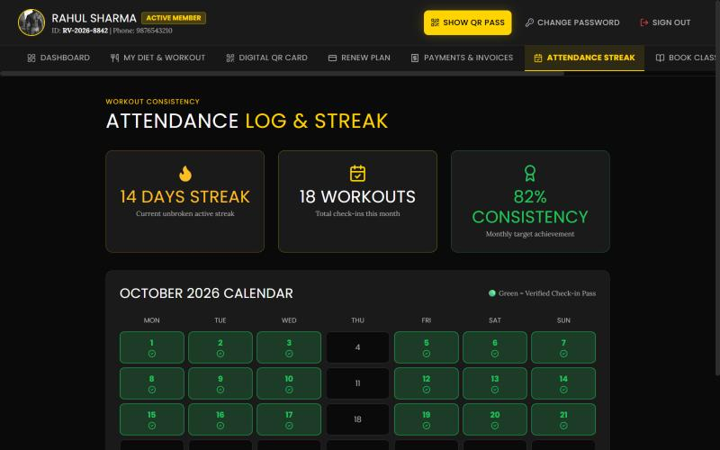
- Shows the current streak, workouts this month, consistency %, and a month calendar with check-in days in green.
- Sample data for now.

### 6.7 Book Classes (`/portal/classes`)
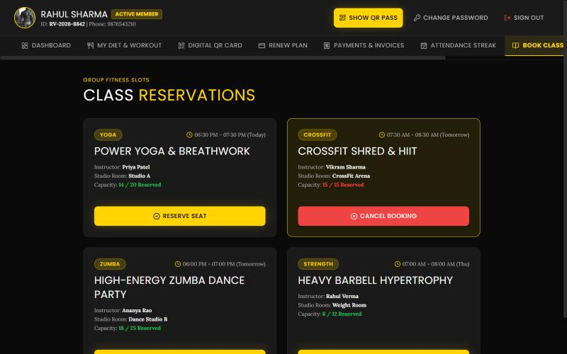
- Each class card shows its time, instructor, room and seats.
- **Reserve Seat** / **Cancel Booking** toggle the booking on screen; it is **not saved yet**.

### 6.8 Body Metrics / Progress Tracker (`/portal/progress`)
| Weight trend | Progress history with private photos |
|---|---|
| 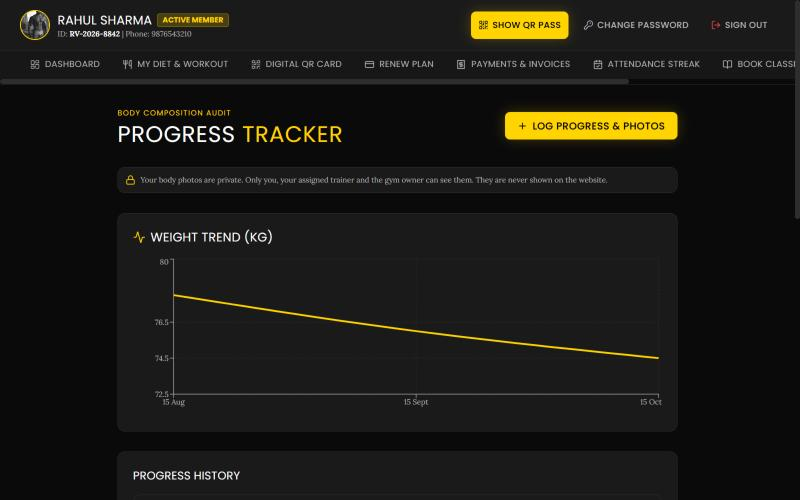 | 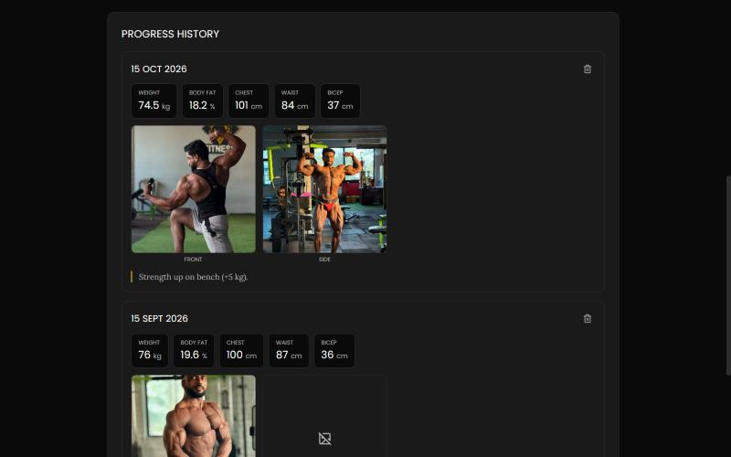 |

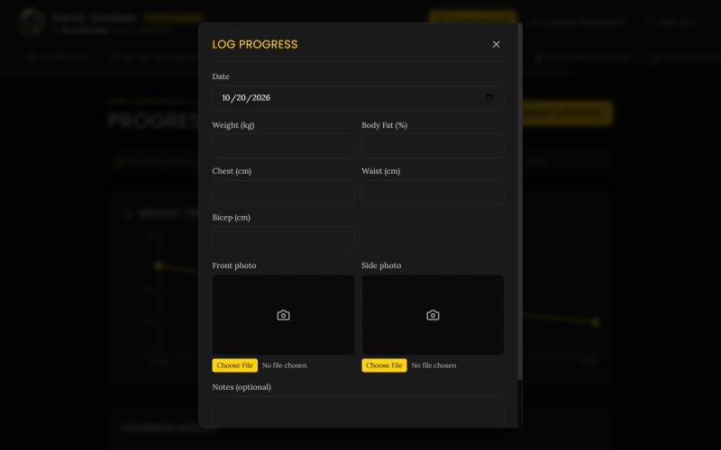

| Function | How it works |
|---|---|
| **Log Progress & Photos** | Fields: date, weight, body fat %, chest, waist, bicep, **front photo**, **side photo**, notes. At least a weight or a photo is required. Photos must be JPG, PNG or WebP, max 5 MB, and preview before saving. |
| Saving | Photos upload to the **private** `progress-photos` bucket in a folder named after the member. The measurements go to the `progress_logs` table, which stores the photo's private location, not a public link. |
| **Weight trend chart** | Drawn from all entries that have a weight, oldest to newest |
| **Progress history** | Newest first, showing each measurement and photo. Photos are shown through **links that expire after 1 hour**. |
| **Delete** (bin icon) | After a confirmation, removes the entry **and** its photos. Only the member can delete. |
| Privacy note | Shown on the page: only the member, their trainer and the gym owner can see the photos |

### 6.9 My Profile (`/portal/profile`)
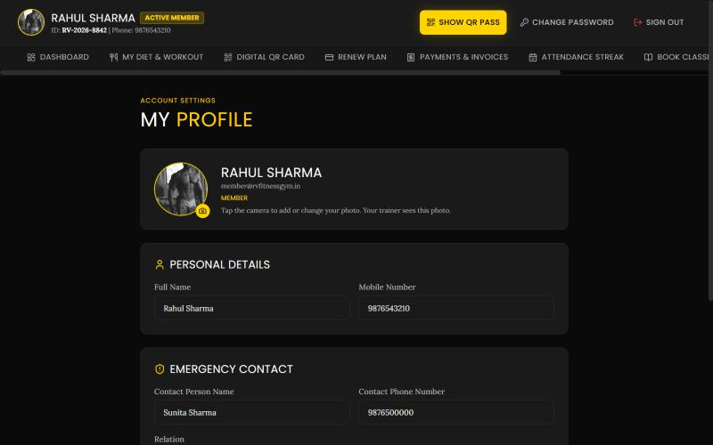

| Function | How it works |
|---|---|
| **Profile photo** (camera button) | Choose a JPG, PNG or WebP photo (max 3 MB). It uploads to the `avatars` bucket in the user's own folder and is saved on the profile. It appears straight away in the header and to the trainer. |
| Personal details | Full name and mobile number (10-digit check) |
| Emergency contact | Name, phone and relation |
| Health & medical notes | Visible to the gym staff and trainer |
| **Save Profile Changes** | Updates the user's `profiles` row. A mobile number already used by another account gets a clear message. |

---

## 7. Trainer panel

### 7.1 Trainer dashboard (`/trainer/dashboard`)
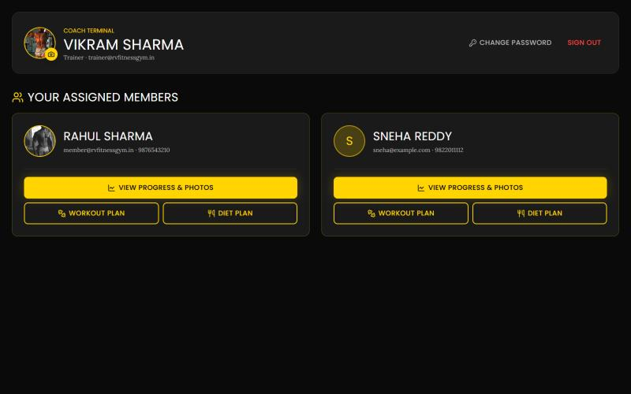

| Function | How it works |
|---|---|
| Header | The trainer's own **photo** (camera button to change it), name, role, **Change Password**, **Sign Out**. Owners and admins also see an **Admin Panel** button. |
| **Your Assigned Members** | Members whose `assigned_trainer_id` is this trainer, with their photos. The owner assigns them in Users & Roles. Admins who open the trainer panel see all members. |
| No members yet | Explains that the gym owner assigns members from Admin → Users & Roles |

### 7.2 Diet and workout plan editor
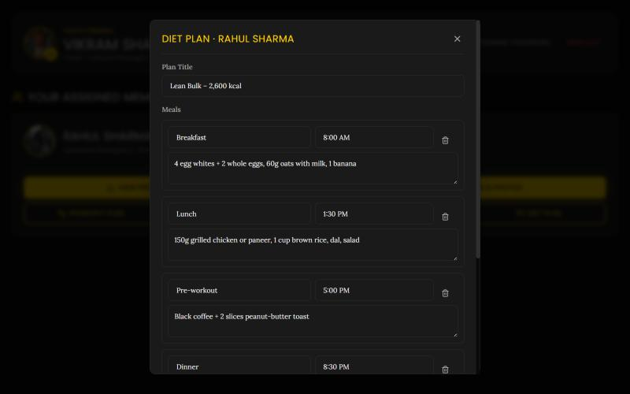
- **Diet Plan** opens the editor, **pre-filled with the member's current plan** so it can be edited.
  - Add a plan title and meals (name, time, foods); add or remove meals; add notes.
- **Workout Plan** works the same way, with training days and exercises.
- **Save & Send to Member:**
  - The new plan is saved first, then older plans are marked inactive and kept as history.
  - The member sees it immediately on **My Diet & Workout**.
- **Who can save:** the database only allows the member's assigned trainer, or an admin. If saving is refused, the error shows and the editor stays open.

### 7.3 View Progress & Photos
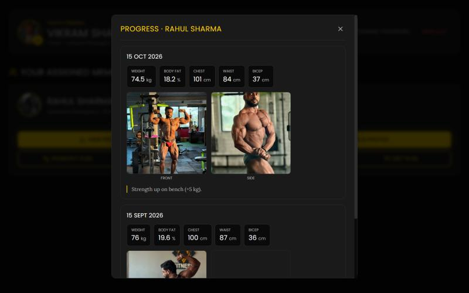
- Opens the member's progress timeline: measurements plus front and side photos, newest first.
- The trainer can **view but not edit or delete**.
- Photos load through temporary private links. The database only allows this for the **assigned** trainer (and admins).

---

## 8. Admin panel

**Sidebar:**
- all admin pages, plus **Users & Roles** (admins) and **Website Editor** (Super Admin)
- the user's photo (camera to change)
- **Change Password** and **Exit Terminal**

**Header buttons:** **Launch Scanner** and **Member View**.

**On phones:** the sidebar starts collapsed to icons.

### 8.1 Overview KPIs (`/admin/dashboard`)
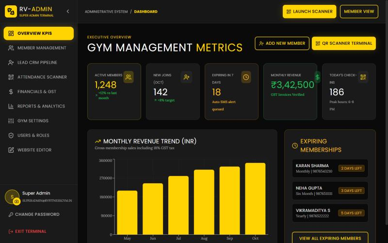
- Shows active members, new joins, memberships expiring soon, monthly revenue, today's check-ins, a revenue trend chart, and expiring memberships.
- **Sample data for now.**

### 8.2 Member Management (`/admin/members`)
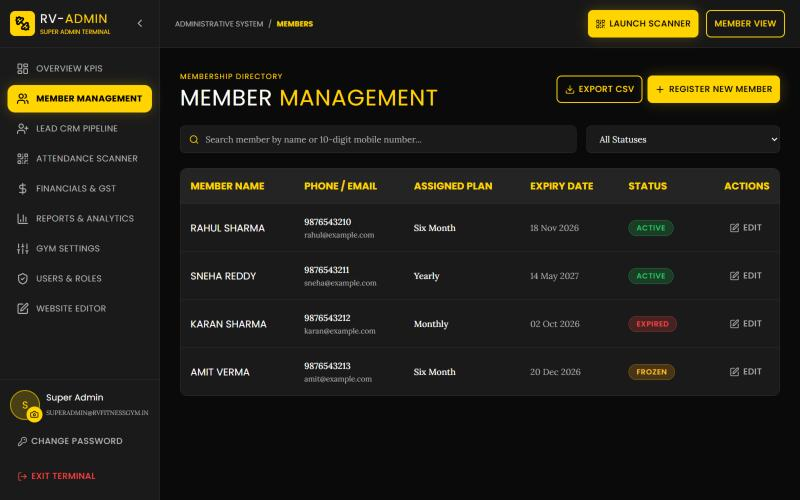
- **Search** by name or mobile and **filter** by status (active, expired, frozen).
- **Register New Member** adds a row on screen. **Export CSV** downloads the current list.
- Sample data; new members are **not saved to the database yet**.

### 8.3 Lead CRM Pipeline (`/admin/leads`)
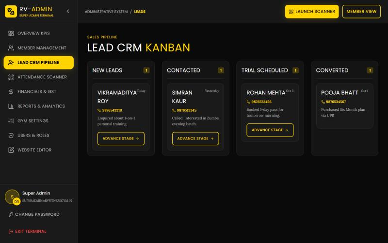
- A board with four stages: New → Contacted → Trial Scheduled → Converted. **Advance Stage** moves a lead along.
- Sample data. Real enquiries from the website are saved in the `leads` table, but this board doesn't read them yet.

### 8.4 Attendance Scanner (`/admin/attendance`)
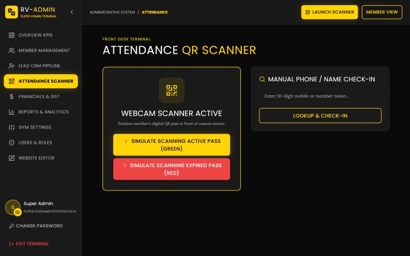
- A front-desk check-in screen. **Simulate** buttons show the result for an active (green) or expired (red) pass. **Manual check-in** looks a member up by phone or name.
- Simulated: the camera is not connected and check-ins are not saved.

### 8.5 Financials & GST (`/admin/financials`)
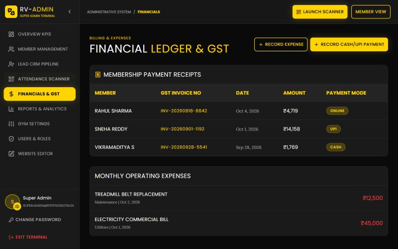
- Membership payment receipts with GST invoice numbers, and monthly expenses.
- **Record Expense** and **Record Cash/UPI Payment** forms add rows on screen. Sample data; **not saved yet**.

### 8.6 Reports & Cron Scheduler (`/admin/reports`)
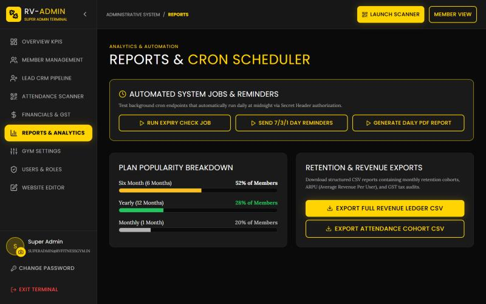
- Buttons for automated jobs (expiry check, 7/3/1-day reminders, daily PDF report), a plan popularity breakdown, and CSV export buttons.
- **Demo only**: the buttons show confirmation messages.

### 8.7 Gym Settings (`/admin/settings`)
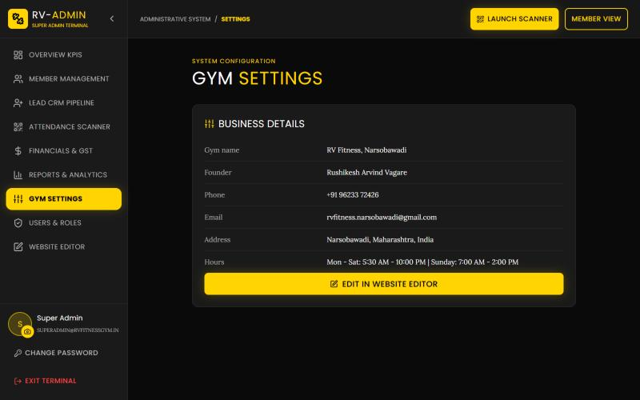
- Shows the business details currently on the website (name, founder, phone, email, address, hours).
- The Super Admin gets **Edit in Website Editor**. Others see "Ask the Super Admin to change them".

### 8.8 Users & Roles (`/admin/users`) — owner, manager, Super Admin
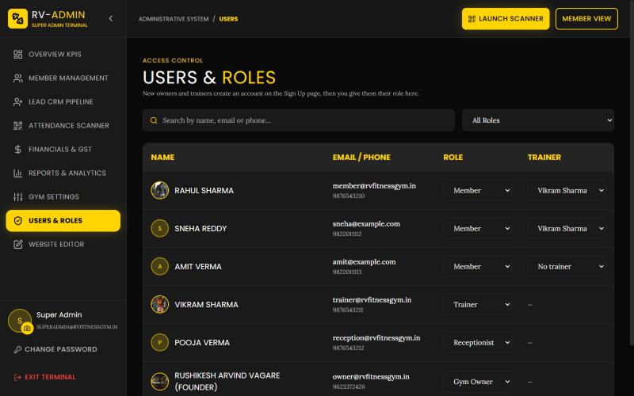

| Function | How it works |
|---|---|
| User list | Every account with photo, email, phone, role and trainer. **Search** by name, email or phone; **filter** by role. |
| **Role** drop-down | Changes the user's role straight away. The Super Admin can grant any role. Owners and managers can grant Member, Trainer, Receptionist and Manager, and cannot change an Owner or Super Admin. Nobody sees a drop-down for themselves. |
| **Trainer** drop-down (members only) | Assigns or removes the member's trainer |
| Errors | If the database refuses a change (for example an owner trying to create an owner), the reason is shown and nothing changes |

---

## 9. Website Editor (Super Admin)

Opened from **Admin → Website Editor** (`/admin/content`). Only the Super Admin can open it, and the database only accepts saves from the Super Admin.

| Gym details | Trainers with image upload | Plans (prices fixed) |
|---|---|---|
| 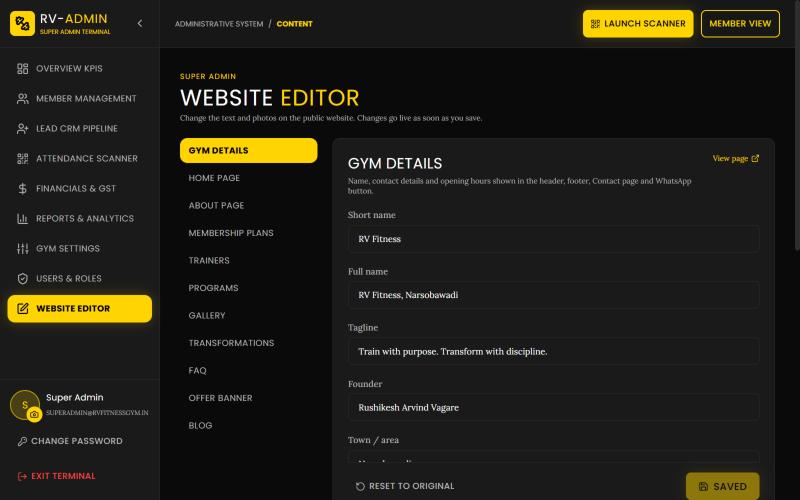 | 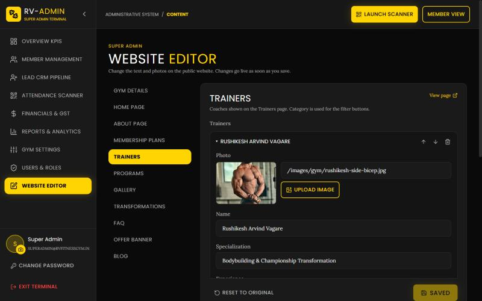 | 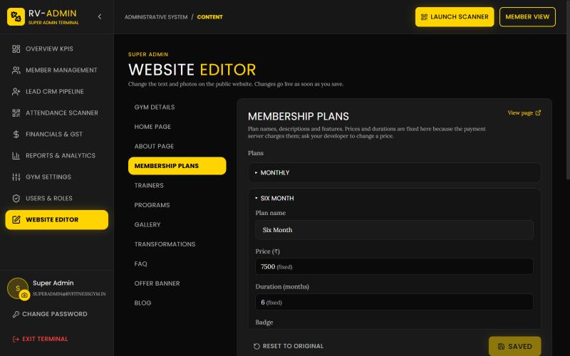 |

**Sections and what they change**

| Section | Changes |
|---|---|
| Gym Details | Name, tagline, founder, address, phone, email, Instagram, hours and about text. Used in the header, footer, contact page and WhatsApp button. |
| Home Page | Banner image, 3-part headline, intro text, "Why RV Fitness" cards, philosophy text |
| About Page | Story, two photos, principles, mindset words |
| Membership Plans | Plan name, badge, description, features, highlight. **Price and duration are fixed** (shown as "fixed"). |
| Trainers / Programs / Gallery / Transformations / FAQ / Blog | Full lists: add, edit, reorder (↑ ↓), remove (with confirmation), upload images |
| Offer Banner | Turn the strip and pop-up on or off; edit their text and the coupon code |

**How it works**
- **Saving:** each section is saved as one row in the `site_content` table. The public pages load all rows when the site opens and use them over the built-in defaults, field by field.
- **Missing content:** if a field is empty or the database can't be reached, the built-in content shows, so the site is never blank.
- **Upload Image:** sends the file (JPG, PNG, WebP or GIF, max 5 MB) to the `site-media` bucket and puts its link into the field. Pasting an image URL also works, and the preview updates.
- **Save Changes** is only enabled when something changed. Switching sections with unsaved changes asks for confirmation.
- **Reset to Original** (with confirmation) deletes the saved row, so the section goes back to the built-in content.
- **View page ↗** opens the matching public page in a new tab.
- **Letting the Gym Owner edit too:** change `can_edit_content()` in the database and `CONTENT_EDITOR_ROLES` in `config/roles.ts` (see [ADMIN-SETUP.md](ADMIN-SETUP.md)).

---

## 10. Photos and privacy

| Photo type | Stored in | Who can see it | Who can change it |
|---|---|---|---|
| Profile photos | `avatars` bucket (public), folder per user | Anyone with the link: portal header, trainer, Users & Roles | Only the user (their own folder) |
| Website images | `site-media` bucket (public) | Everyone (public website) | Super Admin |
| **Body progress photos** | `progress-photos` bucket (**private**), folder per member | **Only** the member, their **assigned trainer**, and owner, manager and Super Admin, through links that expire after 1 hour. Receptionists and other trainers **cannot**. | Only the member (add and delete) |

**Health data:** body measurements (`progress_logs`) follow the same rules as body photos. Health notes are on the profile and visible to staff.

---

## 11. Backend API

Base URL: `VITE_API_BASE_URL` (e.g. `https://api.example.com/api/v1`). Full details are in [API.md](API.md).

| Endpoint | Purpose | Notes |
|---|---|---|
| `POST /leads` | Contact form enquiry | Zod validation, 10-digit phone check, honeypot spam check, saved to `leads` |
| `POST /trial-bookings` | Free gym visit booking | Same checks, saved to `trial_bookings` |
| `GET /plans` | Membership plans | Reads `membership_plans` |
| `GET /classes`, `GET /trainers` | Timetable and trainers | Read-only lists |
| `GET /cms/banners` | Active offers | Read-only |
| `GET`/`PATCH /me` | Member profile | |
| `POST /memberships/checkout` | Creates a payment order | Prices come from `apps/api/lib/plans.ts`, never from the browser. **Order creation is simulated.** |
| `POST /payments/webhook` | Razorpay payment confirmation | Verifies the `x-razorpay-signature` HMAC-SHA256 signature. Activation is a placeholder. |

---

## 12. Database and security

**Migrations** (run in order; see [ADMIN-SETUP.md](ADMIN-SETUP.md)):

| File | What it does |
|---|---|
| `01_initial_schema.sql` | All tables (profiles, plans, memberships, payments, attendance, leads, classes, diet and workout plans, progress logs, blog, gallery…), indexes and base security rules |
| `02_secure_profile_roles.sql` | New sign-ups are always members; users can't raise their own role |
| `03_super_admin_role.sql` | Adds the `super_admin` role |
| `04_roles_plans_content.sql` | Role helper functions, trainer assignment, rules guarding role and trainer changes, trainer permissions for diet and workout plans, `site_content` table, `site-media` bucket |
| `05_photos_and_progress.sql` | `avatars` bucket, `get_my_trainer()`, tighter `progress_logs` rules, private `progress-photos` bucket |

(`supabase/schema_complete.sql` is a single combined script added separately in this project.)

**Key security rules (Row Level Security)**
- Users read and update only their **own** profile. Staff can read all profiles. Trainers can read only their **assigned** members.
- **Role and trainer changes** are checked by a database trigger, using the rules in [section 3](#3-user-roles-and-what-each-can-do).
- **Diet and workout plans:**
  - members read their own
  - the assigned trainer or an admin creates and edits them
- **Progress logs:**
  - the member manages their own
  - the assigned trainer and admins can read them
- **Website content:** everyone can read it; only `can_edit_content()` (Super Admin) can write.
- The Supabase **service key** lives only on the API server, never in the website.

---

## 13. Setup, testing and deployment

| Task | Command / guide |
|---|---|
| Install | `npm install` (repo root) |
| Run the website | `npm run dev:web`, then open `http://localhost:5173` |
| Run the API | `npm run dev:api`, then open `http://localhost:3000` |
| Type-check, all tests and both builds | `npm run verify` |
| First-time setup (Supabase keys, migrations, making yourself Super Admin) | [ADMIN-SETUP.md](ADMIN-SETUP.md), [SETUP.md](SETUP.md) |
| Deploy (Vercel / Netlify) | [DEPLOY.md](DEPLOY.md) |

**Automated tests** (`apps/web/src/**/*.test.tsx`) cover:
- every public page and the content checks
- login, sign-up, forgot and reset password
- route guards for every role
- Users & Roles rules
- trainer → member diet and workout plans
- the Website Editor (save, upload, reset, locked prices)
- profile photos, the My Trainer card, and private progress photos

They use an in-memory fake Supabase (`src/test/supabaseMock.ts`), so they run without internet.

---

## 14. Feature status: live, sample data or simulated

| Feature | Status |
|---|---|
| Public website pages, calculators, offer banner | **Live** |
| Contact enquiry and visit booking forms | **Live** (saved through the API) |
| Email/password login, sign-up, forgot and reset password, change password | **Live** (Supabase Auth) |
| Role-based access (Super Admin, Owner, Manager, Receptionist, Trainer, Member) | **Live** (app and database) |
| Users & Roles, trainer assignment | **Live** |
| Trainer diet and workout plans → member My Diet & Workout | **Live** |
| Profile photos, My Trainer card | **Live** |
| Private body progress photos and measurements, trainer view | **Live** |
| Website Editor with image upload | **Live** |
| Razorpay payments (checkout, webhook activation) | **Simulated**: no real charges |
| Member dashboard figures, QR card details, payment history, attendance, class booking | **Sample data** |
| Admin dashboard, members list, leads board, scanner, financials, reports | **Sample data / demo actions** |
| Coupon codes | Checked only in the browser (not secure) |
| Newsletter signup | Shows confirmation only (no email service) |

"Live" features need migrations `02`–`05` applied to the real Supabase project.

---

## 15. Known limitations and next steps

1. **Real payments:**
   - Add the gym owner's Razorpay keys (in the hosting environment settings, never in code).
   - Build real order creation, signature checks and membership activation.
   - Move coupons to the `coupons` table and check them on the server.
2. **Connect the sample-data screens to the database:**
   - admin dashboard, members, leads (the website enquiries are already saved)
   - attendance scanner (camera plus saving check-ins)
   - financials, reports
   - member dashboard, payments, attendance, class booking, and real member IDs on the QR card
3. **Class timetable:** move it into the Website Editor or the `classes` table.
4. **Newsletter:** connect an email service (e.g. Resend) or remove the form.
5. **Accessibility:** add a label to the mobile ☰ menu button for screen readers.
6. **My Trainer card fallback:** when the trainer can't be loaded, the card currently shows the founder's details as a fallback. Decide whether that is intended, or show "trainer unavailable" instead.
